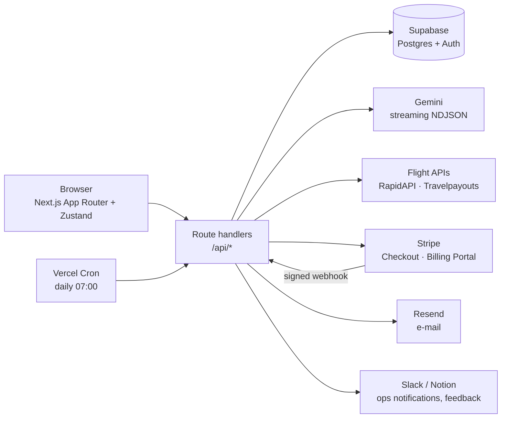

# Włóczykij — AI trip planner for budget weekend travellers

Włóczykij (Polish for Snufkin, the wandering Moomin character) turns a short quiz
into a ready-to-go weekend trip: a destination that fits the budget, real flight
prices from Polish airports, and a day-by-day plan generated by an LLM.
It is a full product, not a demo: auth, paid credits and subscriptions,
transactional e-mails, an admin panel and a cost-aware integration layer
for third-party APIs.

> Built solo, end to end — product, backend, payments, infrastructure and copy.
> The UI and content are in Polish; the code and this README are in English.

<!-- TODO: add screenshot / GIF of the quiz → plan flow -->

## What it does

- **Quiz → destination recommendations** — budget, dates, travel style,
  companion type (solo / couple / family / friends).
- **Real flight prices** — searched across flight APIs, with results cached
  in Postgres to stay inside free-tier quotas.
- **AI-generated itinerary** — Gemini streams the plan day by day; the UI
  renders each day as soon as it arrives instead of waiting ~30 s for the whole plan.
- **Plan editing** — regenerate a single day or swap one activity without
  re-generating the whole trip.
- **Extras** — packing list, restaurant picks, map (Leaflet), PDF export,
  `.ics` calendar export, public share links, pre-trip reminder e-mail.
- **Monetisation** — 5 free credits on sign-up, one-off credit pack,
  monthly/yearly Pro subscription, Stripe billing portal.

## Architecture



| Layer | Tech |
|-------|------|
| Frontend | Next.js 16 (App Router), React 19, Tailwind 4, Framer Motion, Zustand |
| Backend | Next.js route handlers (Node runtime), TypeScript |
| Data & auth | Supabase — Postgres, Auth, SQL migrations, RPC functions |
| AI | Google Gemini (`@google/generative-ai`) |
| Payments | Stripe — Checkout (one-off + subscriptions), webhooks, Billing Portal |
| Infra | Vercel (hosting, cron), Resend (e-mail) |

## Engineering highlights

**Payments flow (Stripe).** Checkout sessions carry the Supabase user id and
plan key in metadata. A webhook handler verifies the Stripe signature on the
raw request body, records every payment in a `payments` table and then either
adds credits (via a Postgres RPC, so the increment is atomic) or extends the
subscription. Renewals use the invoice period end plus a grace buffer;
`customer.subscription.deleted` downgrades the account.

**Streaming LLM output.** The model is prompted to emit NDJSON — a header line
followed by one line per day. `parseNdjsonStream` buffers chunks, splits on
newlines, strips stray markdown fences and pushes each parsed day to the
client as it arrives. `validateAndFixPlan` then repairs the output that
LLMs typically get wrong (missing days, wrong day count) before it is saved.

**Cost control for paid APIs.**
- Flight searches are cached in a `flight_cache` table with a TTL; expired
  entries are cleaned up opportunistically.
- Every external call is logged (`api_usage_log`, `gemini_usage_log`) with
  hit/miss and usage data, so the admin panel shows what each feature costs.
- Per-IP rate limiting on every expensive endpoint (generation, flights,
  chat, checkout); on generation it runs *after* auth so anonymous traffic
  can't burn the quota, and missing credits return `402 Payment Required`.

**Schema as code.** 13 incremental Supabase migrations (`supabase/migrations`)
cover profiles, trips, payments, newsletter double opt-in, public sharing,
caching and usage logs. See [`supabase/README.md`](supabase/README.md) for the workflow.

## Project structure

```text
src/
├── app/
│   ├── api/            # route handlers: generate, checkout, webhook, cron, …
│   ├── plan/[tripId]/  # generated trip view
│   ├── quiz/ quick/    # two entry paths into the planner
│   ├── admin/          # usage & cost dashboard
│   └── components/
├── lib/
│   ├── gemini.ts       # prompt building, NDJSON stream parsing, output repair
│   ├── stripe.ts       # plans & pricing
│   ├── flights/        # flight API adapters + caching
│   ├── supabase/       # browser / server / service-role clients
│   └── rateLimit.ts    # sliding-window limiter
└── content/blog/       # MDX articles (SEO)
supabase/migrations/    # versioned SQL schema
```

## Running locally

```bash
npm install
cp .env.example .env.local   # fill in the keys listed below
npm run dev
```

Required environment variables:

| Group | Variables |
|-------|-----------|
| Supabase | `NEXT_PUBLIC_SUPABASE_URL`, `NEXT_PUBLIC_SUPABASE_ANON_KEY`, `SUPABASE_SERVICE_ROLE_KEY` |
| AI | `GEMINI_API_KEY` |
| Stripe | `STRIPE_SECRET_KEY`, `STRIPE_WEBHOOK_SECRET`, `STRIPE_PRICE_PACK_5`, `STRIPE_PRICE_PRO_MONTHLY`, `STRIPE_PRICE_PRO_YEARLY` |
| Flights & media | `RAPIDAPI_KEY`, `TRAVELPAYOUTS_TOKEN`, `UNSPLASH_ACCESS_KEY` |
| E-mail & ops | `RESEND_API_KEY`, `SLACK_WEBHOOK_URL`, `WHATSAPP_APIKEY`, `WHATSAPP_PHONE`, `NOTION_TOKEN`, `NOTION_FEEDBACK_DB_ID`, `ADMIN_EMAIL`, `CRON_SECRET` |
| App | `NEXT_PUBLIC_APP_URL`, `NEXT_PUBLIC_BASE_URL` |

To test payments locally, forward webhooks with the Stripe CLI:

```bash
stripe listen --forward-to localhost:3000/api/webhook
```

## Known limitations & next steps

Deliberate MVP trade-offs, listed so they're visible rather than hidden:

- **Webhook idempotency** — Stripe delivers events at least once; the handler
  should deduplicate on `event.id` (unique constraint) before granting credits.
- **Rate limiting is in-memory** — fine on warm serverless instances, resets on
  cold start; the next step is a shared store (e.g. Upstash Redis).
- **No automated tests yet** — the first candidates are the NDJSON parser,
  plan repair logic and the webhook handler (with Stripe fixtures).
- **Validation** — hand-written guards in `lib/validate.ts`; moving to zod
  schemas would give shared types and better error messages.
